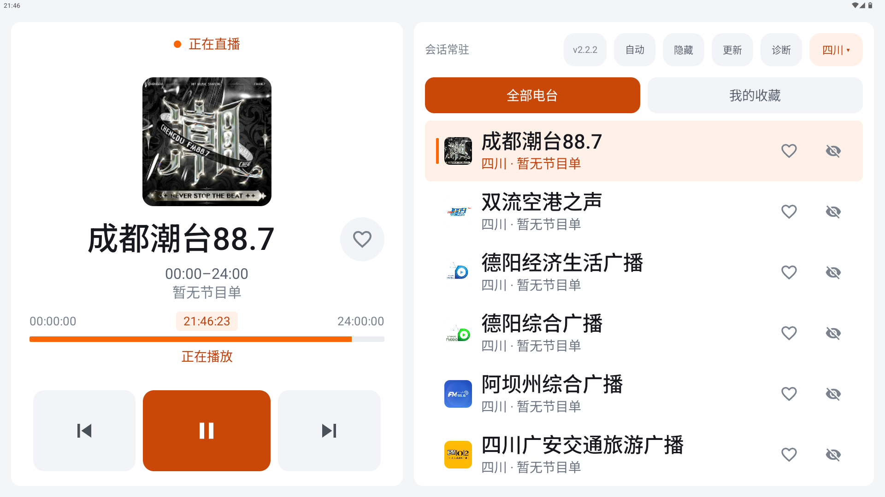
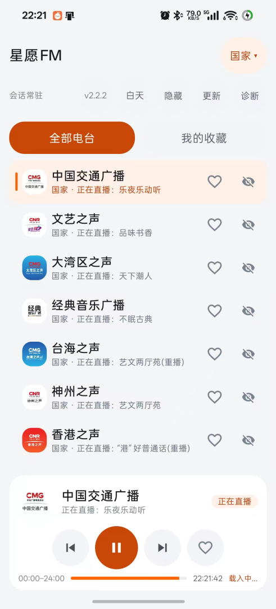
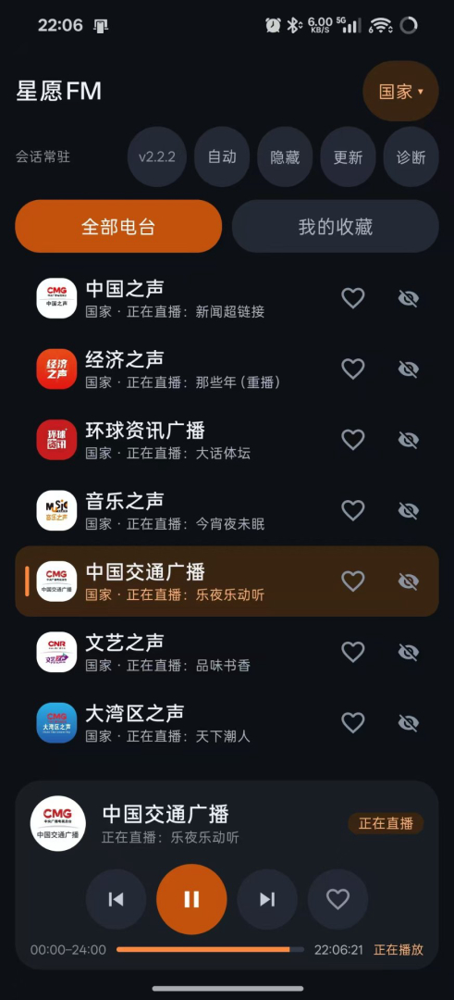

# 星愿收音机（XingyuanRadio）

为吉利星愿车机打造的纯净 FM 收音机，同时适配手机使用。

**无广告 · 无开屏 · 无登录**，接方向盘按键，按所在地自动列出当地电台（四川优先），音质自动择优。

## 特性

- **纯净无打扰**：无广告、无开屏、无登录、无埋点，仅请求电台列表本身
- **智能电台列表**：按 IP 归属地自动列出当地电台，四川优先，支持手动切换省份
- **车机深度适配**：方向盘按键（上一台 / 下一台 / 播放暂停）、车机媒体中心媒体源、数字键直跳、开机续播
- **手机也能用**：竖屏单列布局、横屏自适应，锁屏 / 通知栏显示台标并支持切台
- **音质自动择优**：最高码率优先，卡顿自动降档，断流自动重连，换台无静音空档
- **收藏与隐藏**：本地收藏 / 隐藏电台，跨省收藏可正确回源
- **双主题**：白天 / 夜间 / 跟随系统三态切换
- **应用内更新**：一键检查更新、下载、拉起系统安装

## 界面

车机两栏布局（左控制 / 右列表）：



手机单列布局（OPPO 真机，亮色 / 暗色）：




## 安装

从 [Releases](../../releases) 下载最新版，或直接取 `releases/` 目录下文件名形如
`星愿FM-vX.Y.Z-YYYYMMDD.apk` 的安装包（包名 `com.rea.radio`）。

## 构建

需要 JDK 17 与 Android SDK（compileSdk 34）：

```bash
gradle :app:assembleOfficialRelease
```

产物位于 `app/build/outputs/apk/official/release/`。

> **签名与私有 SDK 需自备**：本公开仓库不携带签名密钥（`keystore/`）与车机媒体中心
> SDK 二进制（`app/libs/eas-sdk.jar`）。签名口令请通过 `local.properties`
> （`key.storePassword` / `key.alias` / `key.keyPassword`）或 `-P` 参数提供；
> 如需车机媒体中心媒体源 / 后台方向盘按键，请自行放入 `app/libs/eas-sdk.jar` 后再构建。

单元测试：

```bash
gradle test
```

## 技术栈

| 项 | 说明 |
|---|---|
| 播放内核 | Media3 ExoPlayer 1.4.1（支持 HLS 两层播放列表） |
| 界面 | Android 原生 View，车机两栏 + 手机单列自适应 |
| 数据源 | 央广 `radio.cn` 公开接口 |
| 构建 | Gradle 8.9 · AGP 8.7.2 · JDK 17 |
| 测试 | Robolectric（200+ 用例） |

## 免责声明

音频流版权归各广播电台所有。本项目仅作为播放器访问央广 `radio.cn` 公开接口，
不缓存、不转存、不分发任何音频内容。该接口为公开网页接口，非官方 SDK，上游变更可能导致失效。
